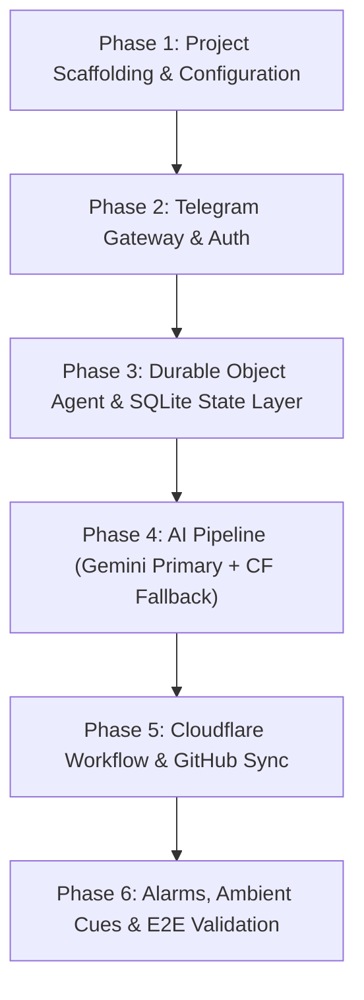

# Cloudflare AI Personal Assistant (`study-agent`) — Implementation Plan

> **Target Platform:** Cloudflare Workers, Cloudflare Agents SDK, Workers AI / Google Gemini, Cloudflare Workflows, Durable Objects (SQLite)  
> **Repository:** `study-agent`  
> **Target Sink:** `sangam-kumar/study-repo`  
> **Development Environment:** Native Windows (PowerShell) + Node v24  

---

## 1. Architectural Decisions & Trade-Offs

### 1.1 Development Environment: Native Windows (PowerShell)
* **No Virtualization Overhead:** Node v24.11.0, npm 11.6.1, and Wrangler v4.147.0 are installed directly on Windows.
* **Elimination of WSL 9P Latency:** Working on `C:\study\study-agent` directly in Windows avoids WSL cross-mount performance degradation on `npm install` and file watchers.
* **Cloudflare `workerd`:** Fully supported native Windows binary for local emulation.

### 1.2 LLM Engine: Pluggable Gemini & Workers AI
* **Primary LLM:** Google Gemini (Gemini 1.5 Flash / 2.0 Flash) via Google AI Studio API.
  * Free tier: 15 RPM, 1M tokens/min, 1,500 requests/day.
  * Superior reasoning, strict JSON structured schema output, and native audio processing.
* **Secondary / Portfolio Fallback:** Cloudflare Workers AI (`@cf/meta/llama-3.3-70b-instruct` and `@cf/openai/whisper`).
* **Design:** Clean LLM interface (`src/ai/provider.ts`) allowing runtime switching via environment variable (`LLM_PROVIDER=gemini` or `cloudflare`).

### 1.3 Audio Handling: Zero Storage Stream
* Audio notes are **never stored** on Cloudflare, SQLite, or disk:
  1. Telegram delivers audio update (`file_id`).
  2. Worker streams audio buffer into memory via Telegram `getFile`.
  3. Audio buffer passed to Gemini (multimodal) or Whisper (Workers AI) for transcription and structured JSON extraction in a single pass.
  4. Memory buffer is immediately garbage collected. Only structured text/JSON is persisted.

### 1.4 Scheduling: Unlimited Reminders via Durable Object Alarms
* Cloudflare free cron triggers have a limit of 3–5 cron expressions in configuration.
* **Solution:** We use **Durable Object Alarms (`this.ctx.storage.setAlarm`)**, which are **unlimited** and free:
  * Reminders are stored in SQLite (`reminders` table).
  * The Durable Object sets an alarm for the earliest upcoming timestamp.
  * When `alarm()` fires, it triggers the cue (08:15 IST, 17:00 IST, 21:30 IST, or ad-hoc custom alarms) and automatically sets the alarm for the next item.

---

## 2. Dependencies & Tooling

### Runtime & CLI Tools
* **Node.js:** v24.11.0 (verified)
* **npm:** 11.6.1 (verified)
* **Cloudflare Wrangler CLI:** `wrangler@^4.147.0` (verified)
* **Local Webhook Tunnel:** `cloudflared` (native Cloudflare tunnel) or `ngrok`

### Project Dependencies (`package.json`)
* **Core Cloudflare Runtime:**
  * `agents-sdk`: Cloudflare Agents SDK for Durable Objects, SQLite persistence, and state.
  * `@cloudflare/workers-types`: TypeScript definitions for Workers, Workflows, Durable Objects.
  * `typescript`: Type checking and compilation.
* **AI & External APIs:**
  * `@google/genai` (or lightweight zero-dependency fetch client for Gemini API).
  * Telegram Webhook types / helper client.
  * Lightweight GitHub REST client using native Workers `fetch`.

### Required Credentials & Secrets

| Variable | Source | Purpose | Phase Needed |
|---|---|---|---|
| `GEMINI_API_KEY` | Google AI Studio | Gemini 1.5/2.0 Flash inference & audio parsing | Phase 4 |
| `TELEGRAM_BOT_TOKEN` | Telegram `@BotFather` | Authenticating Telegram Bot API calls | Phase 2 |
| `TELEGRAM_SECRET_TOKEN` | Random secure string | Validating incoming Telegram webhook requests | Phase 2 |
| `USER_TELEGRAM_CHAT_ID` | Telegram User ID | Access control (single-user authorization) | Phase 2 |
| `GITHUB_PAT` | GitHub Settings (Tokens) | Fine-grained PAT with `contents:write` on `study-repo` | Phase 5 |
| `GITHUB_REPO` | Config (`sangam-kumar/study-repo`) | Target repository for markdown commits | Phase 5 |
| `CLOUDFLARE_API_TOKEN` | Cloudflare Dashboard / CLI | Deployment to Cloudflare edge | Phase 6 |

---

## 3. Implementation Workflow Protocol

To ensure small, solidified, easily chunkable steps:
1. **Phase Implementation Doc:** Prior to executing any phase, create a specific phase guide (`docs/phase-X-<name>.md`) breaking down tasks into discrete sub-steps with exact validation checks.
2. **Step-by-Step Execution:** Execute one discrete sub-step at a time.
3. **Logistics & Pre-Flight Validation:** Confirm required tokens, environment variables, and network connectivity before writing code that depends on them.
4. **Testing & Solidification:** Verify each sub-step before advancing to the next.
5. **Living Plan Sync:** Update this master plan whenever design adaptations occur.

---

## 4. Master Phased Roadmap

### Phase 1: Project Scaffolding & Configuration (Completed)
* **Phase Doc:** `docs/phase-1-scaffolding.md`
* **Sub-steps:**
  - [x] 1.1: Initialize `package.json` with scripts and core dependencies.
  - [x] 1.2: Configure `tsconfig.json` for Cloudflare Workers & modern ESNext.
  - [x] 1.3: Configure `wrangler.jsonc` (bindings for Durable Objects + SQLite, Workflows, Assets/AI).
  - [x] 1.4: Set up folder structure and stub entrypoint files.
  - [x] 1.5: Validate compilation via `npm run typecheck` and `npx wrangler types`.

### Phase 2: Telegram Gateway & Security Layer (Completed)
* **Phase Doc:** `docs/phase-2-telegram.md`
* **Logistics Check:** Verified `TELEGRAM_BOT_TOKEN`, `TELEGRAM_SECRET_TOKEN`, `USER_TELEGRAM_CHAT_ID`.
* **Sub-steps:**
  - [x] 2.1: Implement webhook endpoint with `X-Telegram-Bot-Api-Secret-Token` validation.
  - [x] 2.2: Add chat ID access-control guard.
  - [x] 2.3: Build lightweight Telegram API client (`sendMessage`, `getFile`).
  - [x] 2.4: Live deployment and webhook verification with Telegram Bot API.

### Phase 3: Durable Object Agent & SQLite State Layer (Completed)
* **Phase Doc:** `docs/phase-3-durable-object.md`
* **Sub-steps:**
  - [x] 3.1: Define embedded SQLite schema (`bot_state`, `interaction_logs`, `reading_queue`, `workout_logs`, `reminders`) in `src/db/schema.ts`.
  - [x] 3.2: Implement `StudyAgent.onStart()` SQLite initialization and migration.
  - [x] 3.3: Implement typed CRUD operations and dynamic snooze handlers (`snooze_until`, `clearSnooze`).
  - [x] 3.4: Wire Telegram updates to `interaction_logs` & implement state inspection commands (`/status`, `/queue`, `/snooze`, `/unsnooze`, `/recent`).

### Phase 4: AI Pipeline (Gemini Primary + CF Fallback) (Completed)
* **Phase Doc:** `docs/phase-4-ai-pipeline.md`
* **Logistics Check:** Verified `GEMINI_API_KEY`.
* **Sub-steps:**
  - [x] 4.1: Build generic `LLMProvider` interface and JSON schemas (`src/ai/schemas.ts`, `src/ai/provider.ts`).
  - [x] 4.2: Implement Gemini provider with structured JSON extraction (`src/ai/gemini.ts`).
  - [x] 4.3: Implement in-memory audio-to-JSON handling (zero disk storage) in Gemini provider.
  - [x] 4.4: Implement Workers AI fallback provider with Llama 3.3 and Whisper (`src/ai/workers-ai.ts`).
  - [x] 4.5: Wire LLM provider into `StudyAgent` for voice memo transcription, workout parsing, and text analysis.

### Phase 5: Cloudflare Workflow & GitHub Sync (Parked for Post-MVP)
* **Phase Doc:** `docs/phase-5-workflow-github.md`
* **Status:** Deferred/Parked per user request to prioritize core agentic loops, ambient cues, and MVP validation.

### Phase 6: Alarms, Ambient Cues & End-to-End Validation (Completed)
* **Phase Doc:** `docs/phase-6-alarms-e2e.md`
* **Sub-steps:**
  - [x] 6.1: Register 3 daily recurring ambient cue crons in `onStart()` (08:15 IST morning cue, 17:00 IST commute read, 21:30 IST evening synthesis).
  - [x] 6.2: Implement `morningCue`, `commuteCue`, and `eveningSynthesis` handlers with reading queue and workout aggregation.
  - [x] 6.3: Implement dynamic snooze checking across all cues (`isCurrentlySnoozed()`).
  - [x] 6.4: Implement ad-hoc reminder scheduler (`/remind <minutes> <text>` and `/reminders`).
  - [x] 6.5: Provide manual testing commands (`/cues`, `/testcue <morning|commute|evening>`) for immediate verification.

---

## 5. Product Loop (v3) — Phases 7–14

> **Spec of record:** `C:\study\study-repo\projects\study-agent-spec.md` (v3). The copies of the spec/context in this repo are the stale v1 — do not build from them. Step IDs in brackets (W0, W1a…) cross-reference `study-repo/tracker/reform-plan.md` §6, which owns priority and acceptance tests.

### 5.1 Gap analysis — what v1 built vs what the product loop needs

| Area | Built (Phases 1–6) | Needed | Action |
|---|---|---|---|
| Transport, auth, idempotency | webhook + secret + chat-id guard; no dedupe | `update_id` dedupe | add in P7 |
| State | `bot_state`, `interaction_logs`, `reading_queue`, `workout_logs`, `reminders` | event log, revisions, day_plan/plan_item, tracks/units/pointers, overrides, targets, notes, sessions | additive migration; keep v1 tables until replaced |
| Intents | `workout_log`, `study_note`, `snooze`, `reminder`, `general` (single `parseText`) | closed typed-op set (spec §11) validated against schemas, lane cards | rewrite `schemas.ts`; `provider.ts` → `infer(task, schema, inputs)` |
| Scheduling | 3 fixed cues registered in `onStart()` (08:15 / 17:00 / 21:30), snooze, `/remind <minutes>` | evening recap + proposal, 23:00 auto-lock, wake-triggered morning with fallback, absolute-time reminders with repeat, one alarm = MIN(next job, next reminder) | replace `registerAmbientCues`; drop the 17:00 commute cue |
| Overrides | `snooze` only | `TRAVEL/SICK/OUT/LOW_MOOD`, undo | P11 |
| Fitness | `workout_logs` row per message | one session per date, chunk ops, set notation (`kg × reps`) | P13 |
| Mirror to repo | `github/client.ts` stub; **Phase 5 parked** | commit at lock, regenerate reading-queue | P12 (unpark) |
| Voice | in-memory audio → Gemini (good) | route through the same op pipeline | reuse |
| Tests | manual `/testcue` | per-phase acceptance checks | each phase doc |

### Phase 7: Schema v2, op applier, serial queue [W0] (Completed, not yet deployed)
* **Phase Doc:** `docs/phase-7-schema-v2.md`
* **Sub-steps:**
  - [x] 7.1: Migration `v2` adding tables from spec §6 (`event`, `revision`, `day_plan`, `plan_item`, `track`, `unit`, `pointer`, `override`, `note`, `target`, `lane`, `config`, `inbox`). v1 tables untouched.
  - [x] 7.2: `ops.ts` — op types + validators; `applyOp()` does mutation + `event` + `revision` in one transaction.
  - [x] 7.3: `update_id` idempotency key on `event`; replaying a Telegram update applies once.
  - [x] 7.4: Per-user serial queue (promise chain) around `handleTelegramUpdate`; `version` check with one rebase on mismatch.
  - [x] 7.5: `undo` = apply inverse from `revision`.
* **Check:** same update twice → one effect; undo restores; two concurrent updates → both applied, none lost.

### Phase 8: Seeding [W1a, W1b, W1c] (8.1 done; 8.2 script done, review pending)
* **Phase Doc:** `docs/phase-8-seed.md`
* **Approach:** seed *scripts* live in `study-repo/scripts/` and emit reviewable JSON (`seed/study.json`, `reading.json`, `gym.json`). The agent gets an authenticated admin endpoint `POST /admin/seed` (secret header) that loads a JSON file into SQLite. The LLM is not in the load path.
* **Sub-steps:**
  - [x] 8.1: `/admin/seed` endpoint + loader (idempotent upsert by stable ids).
  - [~] 8.2: **Script written 2026-10-26** (`study-repo/scripts/seed_study.py` → `seed/study.json`; review of the JSON still pending, LLM split proposals not yet run). Study seed script — DSA from `study/problem-lists/dsa-sheet.md`; system design from `big-tech-prep-plan.md` + `system-design-curriculum.md`; frontier lab from `frontier-lab.md`. All pointers at unit 1. Prior `problems/` solutions attached as `ref` only. LLM may *propose* splits of oversized units into the JSON for review.
  - [x] 8.1b: `POST /admin/reset` — scoped, dry-run by default, cancels matching reminder alarms (added so v1 test data can be cleared; see `docs/phase-8-seed.md` §7).
  - [ ] 8.3: Reading + config seed (`reading-queue.md` → items, library → `backlog`, targets incl. sleep 7/8, guitar lane `paused`).
  - [ ] 8.4: Gym seed (pattern, rotation, exercise catalog, Oct sessions from `life/gym-tracking.md`; lane disabled).
* **Check:** loads into an empty DB; `query_plan` returns unit 1 for every track; no unit starts done.

### Phase 9: Inference interface, base card, lane cards, snapshot [W2]
* **Phase Doc:** `docs/phase-9-context.md`
* **Sub-steps:**
  - [ ] 9.1: `infer(task, schema, inputs)` over the existing Gemini/Workers AI providers; failover on 429; model names stay config.
  - [ ] 9.2: Base card (~500 tokens) + lane cards (fitness, study, reading, reminders) as static strings.
  - [ ] 9.3: `snapshot.ts` — today's plan, active overrides, unexpired notes, last N events for the lane.
  - [ ] 9.4: Replace `parseText` with classify → lane extractor → validate (one retry) → apply; low confidence → `inbox`.
* **Check:** context packet < 1k tokens for a normal message; forced Gemini 429 falls through to Workers AI.

### Phase 10: Day loop — evening lock, wake-triggered morning [W3, W4]
* **Phase Doc:** `docs/phase-10-day-loop.md`
* **Sub-steps:**
  - [ ] 10.1: `plan.ts` — pure functions: `draftDay(date)` from pattern + overrides + pointers + `place` (spec §4, §5c). No LLM.
  - [ ] 10.2: Evening 21:30: recap from `event` and proposed tomorrow, with the bedtime line for a `GYM` day's `wake_by`.
  - [ ] 10.3: 23:00 auto-lock (`locked_by='auto'`); edits after lock still apply as ops.
  - [ ] 10.4: Morning: fires on `up`/first message (records `wake` event) or at fallback 09:30 weekdays / 10:30 weekends; filled template only.
  - [ ] 10.5: Scheduler: one DO alarm at MIN(next job, next reminder); remove `commuteCue` and the fixed 08:15.
* **Check:** no reply → tomorrow `locked/auto` at 23:00; morning text equals the locked plan; replayed update doesn't double-apply.

### Phase 11: Overrides, place, sleep/wake [W5]
* **Phase Doc:** `docs/phase-11-overrides.md`
* **Sub-steps:**
  - [ ] 11.1: Ops `set_override` (`TRAVEL/SICK/OUT/LOW_MOOD`), `skip`, `move`, `add_item`; confirmation line + undo.
  - [ ] 11.2: `LOW_MOOD` → minimum item per lane.
  - [ ] 11.3: `place` per date; Sunday question "which 2 days in office?" (default = last week's pair).
  - [ ] 11.4: `bed`/`wake` events from `sleeping`/`up`; sleep average derived.
  - [ ] 11.5: Retire v1 `snooze` into overrides.
* **Check:** "traveling Fri–Sun" → Fri–Sun drafts have no gym, fragment-only study; "undo" restores.

### Phase 12: Repo mirror (unparks Phase 5) [M1]
* **Phase Doc:** `docs/phase-12-mirror.md`
* **Sub-steps:**
  - [ ] 12.1: GitHub client: read/write file with sha; one commit per lock for `daily/<y>/<m>/<date>.md`.
  - [ ] 12.2: Regenerate `study/reading/reading-queue.md` from the reading items.
  - [ ] 12.3: Failure policy: a commit failure never blocks the Telegram reply; retried at the next lock.
* **Check:** a locked day produces exactly one commit; re-lock with no change produces none.

### Phase 13: Fitness lane [W9]
* **Phase Doc:** `docs/phase-13-fitness.md`
* **Sub-steps:**
  - [ ] 13.1: `workout_session` (UNIQUE date) / `session_exercise` / `session_set`; migrate v1 `workout_logs`.
  - [ ] 13.2: Set-notation parser (`kg × reps` for dumbbell/machine; single weight, duration or `BW` for activity; `(1m)` rest; failure marker).
  - [ ] 13.3: Chunk ops (`ensure_session`, `add_sets`, `amend_set`, …), duplicate → one-tap ask, version rebase.
  - [ ] 13.4: Rotation pointer advances on a logged lift; protein number at evening; weekly targets in the recap.
* **Check:** two voice chunks 1 s apart → one session, no lost sets; skip Wed → Thu offers it again; late chunk reopens the same-day session.

### Phase 14: Nudges, reminders v2, weekly, jots [W6, W7, W8, J1]
* **Phase Doc:** `docs/phase-14-nudges-weekly.md`
* **Sub-steps:**
  - [ ] 14.1: Nudge budget (≤3 agent messages/day, quiet 22:30→wake, quiet-after-2-ignored, "pause or resume?").
  - [ ] 14.2: Reminders v2 — absolute `due_ts`, repeat rule, Done/Snooze/Tomorrow buttons, one repeat then evening recap (extends the v1 `reminders` table).
  - [ ] 14.3: Sunday weekly summary from events (targets, sleep average, office-day question).
  - [ ] 14.4: `jot` + `progress` intents; `study/notes/<slug>.md` projection.
* **Check:** see reform-plan §6 acceptance table.

### Order of execution
P7 → P8 → P9 → P10 (**start living on it here**) → P12 → P11 → P13 → P14, then 14 days untouched. P12 is pulled forward because it closes the commit gap as a side effect.

### Housekeeping (not a phase)
- [ ] Replace the stale `study-agent-spec.md` / `study-agent-context.md` copies in this repo with a one-line pointer to the study-repo spec, so there is one source of truth.
- [ ] Confirm `.dev.vars` is gitignored.

